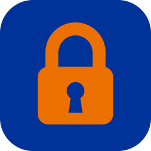
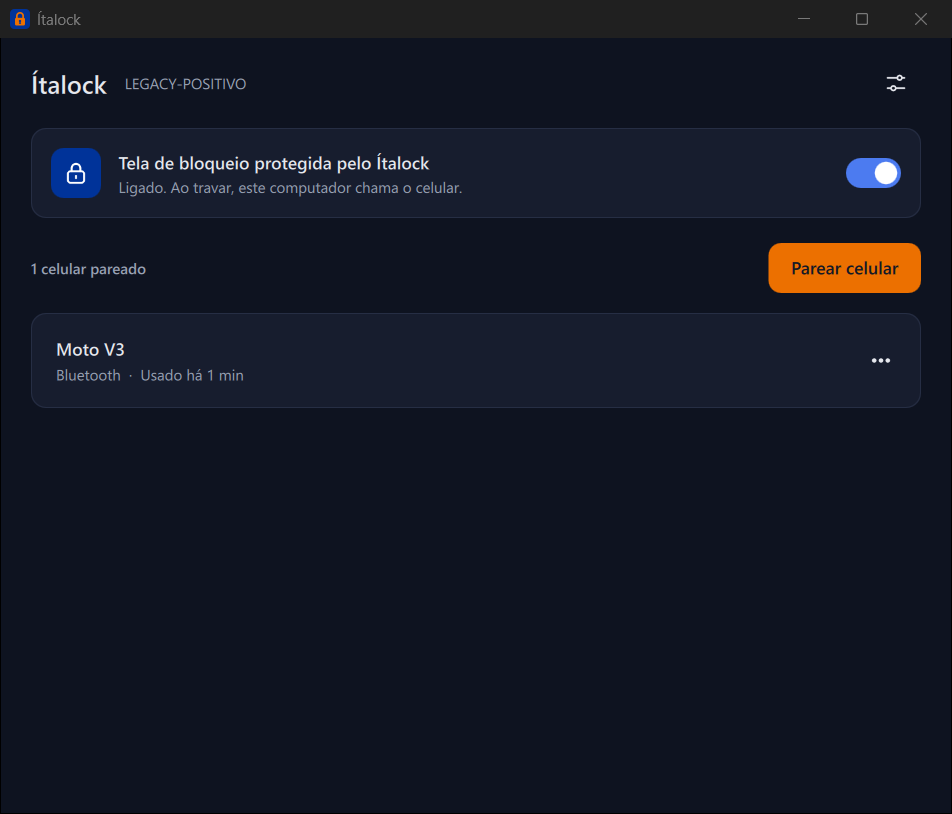
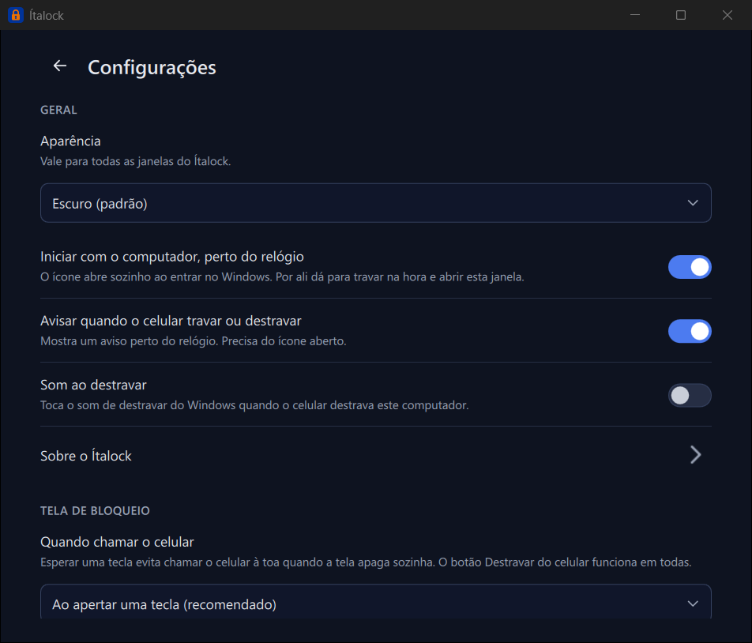
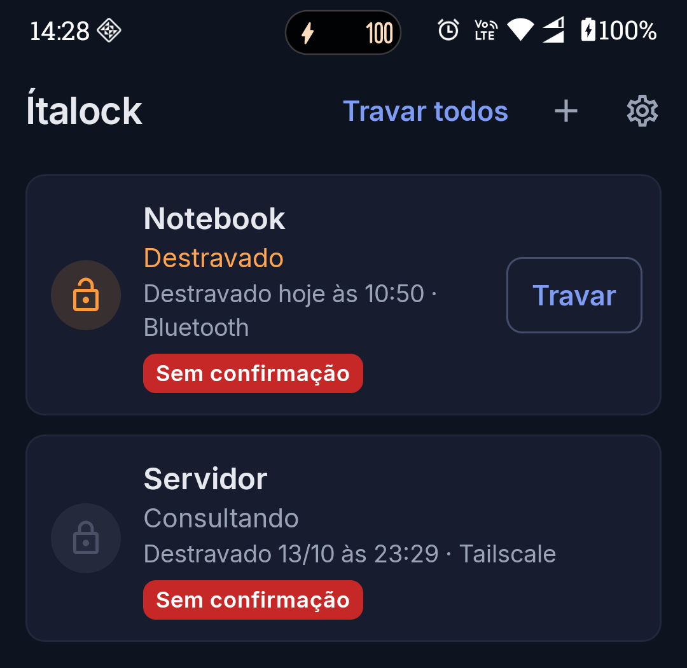
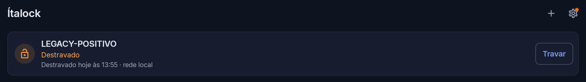
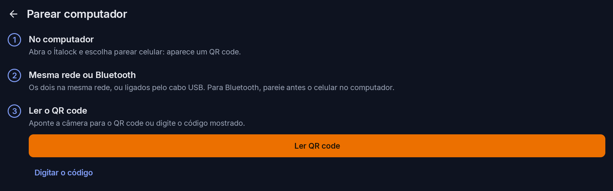

[Português (Brasil)](README.md) · [English](README.en.md) · [Español](README.es.md) · [Français](README.fr.md) · [Deutsch](README.de.md) · [Italiano](README.it.md) · **日本語** · [한국어](README.ko.md) · [简体中文](README.zh-CN.md) · [Русский](README.ru.md) · [Polski](README.pl.md) · [हिन्दी](README.hi.md) · [العربية](README.ar.md)

<div align="center">



# Ítalock

**スマホの指紋でパソコンのロックを解除。**

毎回パスワードを入力する代わりに、パソコンがあなたの Android スマホに確認を求め、あなたは指紋または顔で承認するだけ。スマホからワンタップでパソコンをロックすることもできます。近くからでも、離れた場所からでも使えます。

[](https://github.com/Oitalao/Italock/releases/latest)
[](LICENSE)


</div>

## ダウンロード

必要なものは **2つ** です。パソコン用のプログラムと、スマホ用のアプリです。

| 使う場所 | ファイル | 対応環境 |
| --- | --- | --- |
| 💻 **Windows パソコン** | [**ItalockWindows.exe をダウンロード**](https://github.com/Oitalao/Italock/releases/latest/download/ItalockWindows.exe) | Windows 10 / 11（64 ビット） |
| 📱 **Android スマホ** | [**Italock.apk をダウンロード**](https://github.com/Oitalao/Italock/releases/latest/download/Italock.apk) | Android 6 以降 |
| 🐧 Linux パソコン | [ItalockLinux.run をダウンロード](https://github.com/Oitalao/Italock/releases/latest/download/ItalockLinux.run) | Ubuntu 22.04、Linux Mint 21、Debian 12 以降 |

すべて無料で、広告なし、登録不要、インターネット接続も必須ではありません。以前のバージョンは[リリース](https://github.com/Oitalao/Italock/releases)ページにあります。

## できること

- 🔓 **スマホの指紋または顔でパソコンのロックを解除**。ロック画面でも、Windows のサインイン画面でも使えます。
- 🔒 **スマホからパソコンをロック**。アプリから、ホーム画面のウィジェットから、通知パネルのショートカットから、または NFC タグにスマホをかざしてロックできます。
- 🛜 **Wi-Fi、USB ケーブル、Bluetooth で動作します。** 離れた場所からでも、無料のプライベートネットワーク [Tailscale](https://tailscale.com/) を使えば動作します。
- 🖥️ **1台のスマホで複数のパソコン**、1台のパソコンで複数のスマホを、制限なく使えます。
- 🔑 **パスワードはそのまま使えます。** Ítalock はサインインを速くするための方法にすぎません。スマホの電池が切れていたり手元になかったりしても、いつもどおりパスワードを入力すれば大丈夫です。
- 🌐 **13 の言語に対応。** 最初はポルトガル語で起動します。言語を変えるには、パソコンでもスマホでも **Configurações**（設定）を開いて **Idioma**（言語）を選んでください。初期状態はダークテーマで、ライトテーマにも切り替えられます。

<p align="center">
  
  
</p>
<p align="center">
  
</p>
<p align="center">
  
</p>

## インストール方法

手順は3つです。パソコンにインストールし、スマホにインストールし、最後に1回だけ両方をつなぎます。

### 1. パソコン（Windows）

1. [**ItalockWindows.exe**](https://github.com/Oitalao/Italock/releases/latest/download/ItalockWindows.exe) をダウンロードして開きます。
2. **「Windows によって PC が保護されました」** というメッセージが出ることがあります。Microsoft のデジタル署名を購入していないプログラムで表示されるものです。**詳細情報** をクリックしてから **実行** をクリックします。
3. Windows が許可を求めてきたら **はい** をクリックし、インストーラーを最後まで進めます。
4. Ítalock が自動で起動し、時計の近くにアイコンが表示されます。

> [!IMPORTANT]
> **Windows に Microsoft アカウント（メールアドレスのアカウント）でサインインしていますか？** その場合、PIN や顔だけでなくパスワードでもサインインできるようにしておく必要があります。**設定 › アカウント › サインイン オプション** を開き、*「セキュリティ向上のため、このデバイスでは Microsoft アカウントに Windows Hello サインインのみを許可する」* を **オフ** にしてください。アカウントのパスワードを作ったことがない場合は、[account.microsoft.com](https://account.microsoft.com/security) で作成してください。

### 2. スマホ（Android）

1. スマホで [**Italock.apk**](https://github.com/Oitalao/Italock/releases/latest/download/Italock.apk) をダウンロードし、ダウンロードしたファイルをタップします。
2. このソースからはアプリをインストールできないと表示されたら、**設定** をタップし、**この提供元のアプリを許可** をオンにして戻ります。
3. Google Play プロテクトの警告が出たら、**詳細** をタップしてから **インストールする** をタップします。この警告は Play ストア以外から入手したアプリすべてに表示されます。
4. Ítalock を開いて通知を許可します。**設定** の *許可が必要* セクションにある各項目で **許可** / **除外する** をタップしてください。これで Android にアプリを閉じられなくなります。

### 3. スマホとパソコンをつなぐ（1回だけ）

1. パソコンとスマホを **同じ Wi-Fi** につなぎます（または USB ケーブルでつなぎます）。
2. パソコンで Ítalock を開き、**スマホをペアリング** をクリックします。QR コードが表示されます。
3. スマホで Ítalock を開き、**+** をタップしてから **QRコードを読み取る** をタップします。カメラをパソコンの画面に向けてください。
4. 完了です。スマホの画面にパソコンが表示されます。

<p align="center">
  
</p>

## 毎日の使い方

**ロックを解除するには：** パソコンがロックされた状態で、どれかキーを押します。スマホに通知が届くので、タップして指紋か顔で承認します。パソコンのロックが自動で解除されます。

パソコンに近づかずに、**スマホだけで** ロックを解除することもできます。Ítalock を開き、パソコンのカードにある **ロック解除** をタップしてください。

**ロックするには：** アプリで **ロック** をタップします。お好みで、Ítalock のウィジェットをホーム画面に、ショートカットを通知パネルに追加することもできます（パネルを引き下ろし、鉛筆アイコンをタップして Ítalock をドラッグします）。

## よくある質問

<details>
<summary><b>安全ですか？</b></summary>

はい。スマホとパソコンはインターネット上のサーバーを経由せずに直接やり取りし、通信はすべて暗号化されています（AES 256）。ロック解除の要求には毎回あなたの指紋、顔、またはスマホの画面ロックが必要で、有効なのは数秒だけです。Windows のパスワードはパソコン側に暗号化して保存され、それを開く鍵はスマホにしかありません。片方だけでは何の役にも立ちません。さらにソースコードは公開されているので、プログラムが何をしているかは誰でも確認できます。

</details>

<details>
<summary><b>スマホをなくしたり、電池が切れたりしたら？</b></summary>

いつもどおりパスワードを入力してください。Ítalock がサインイン画面からパスワード、PIN、Windows Hello を取り除くことはありません。選択肢を1つ増やすだけです。スマホをなくした場合は、パソコンで Ítalock を開き、そのスマホを一覧から削除してください。

</details>

<details>
<summary><b>スマホに通知が届きません。</b></summary>

- 両方が同じ Wi-Fi につながっているか、または両方で Bluetooth がオンになっているか確認してください。
- スマホで Ítalock › **設定** を開き、*許可が必要* にある項目をすべて許可してください。特に **バッテリーの最適化** が重要です。一部のスマホ（Xiaomi、Samsung、Motorola）はバックグラウンドのアプリを閉じてしまいます。端末のバッテリー設定で「Ítalock」を探し、**制限なし** を選んでください。
- パソコンにウイルス対策ソフトやファイアウォールがある場合は、そこで Ítalock を許可してください。

</details>

<details>
<summary><b>外出先など、離れた場所からでも使えますか？</b></summary>

はい、無料の [Tailscale](https://tailscale.com/download) を使えば使えます。パソコンとスマホの両方に Tailscale をインストールし、同じアカウントでサインインしてください。そうすれば、Ítalock はどこからでもパソコンを見つけられます。

</details>

<details>
<summary><b>iPhone で使えますか？</b></summary>

いいえ。今のところ Android のみです。

</details>

<details>
<summary><b>アンインストールするには？</b></summary>

- **Windows：** 設定 › アプリ › Ítalock › アンインストール。ペアリング済みのスマホも削除するかどうか確認されます。
- **Linux：** `sudo sh ItalockLinux.run --desinstalar`
- **Android：** ほかのアプリと同じ方法で削除できます。

</details>

## Linux

Linux 用のインストーラーは1つのファイルです。ダウンロードしたフォルダーでターミナルを開き、次を実行します。

```bash
sudo sh ItalockLinux.run
```

Linux では、Ítalock は **スクリーンセーバー**（パソコンがロックされたときに表示される画面）を担当します。ログイン、`sudo`、SSH は引き続きパスワードだけで使います。

| デスクトップ環境 | スマホでロック解除 | スマホでロック |
| --- | :---: | :---: |
| Cinnamon (Linux Mint), MATE, XFCE | ✅ | ✅ |
| GNOME (Ubuntu), KDE Plasma | ❌ | ✅ |

## 試験的な機能

初期状態ではオフになっていて、スマホの **設定 › 試験運用機能** にあります。いろいろ試してみたい人向けです。

- **近くにいるときに自動でロック解除**。Bluetooth または同じネットワーク経由で動作します。
- **通知からロック解除**。アプリを開く必要はありません。
- **Wear OS ウォッチ**（Galaxy Watch、Pixel Watch など）：要求がウォッチに表示されます。ウォッチに [ItalockRelogio.apk](https://github.com/Oitalao/Italock/releases/latest/download/ItalockRelogio.apk) をインストールする必要があります。

## 開発者向け

| フォルダー | 内容 |
| --- | --- |
| [`desktop/`](desktop) | パソコン用プログラム（C++ 20 と Qt 6）、Windows のロック画面用モジュール、Linux の PAM モジュール、スマホからの要求を受け取るエージェント |
| [`android/`](android) | スマホ用アプリ（Kotlin と Jetpack Compose）と Wear OS ウォッチ用アプリ |
| [`scripts/`](scripts) | Windows と Linux 用のビルドスクリプト |
| [`docs/`](docs) | スマホとパソコンの間のプロトコル、アイコン、画像 |

ビルド方法は [`docs/COMPILAR.md`](docs/COMPILAR.md)（ポルトガル語）を参照してください。

## クレジットとライセンス

パソコン用プログラムは MeisApps の [**PC Bio Unlock**](https://github.com/MeisApps/pcbu-desktop) のフォークで、新機能を追加しています。複数のペアリング、Tailscale を使った遠隔でのロック解除、スマホからのロック、新しい画面デザイン、そしてポルトガル語を主言語としたことです。スマホ用アプリはゼロから書き起こしたもので、同じプロトコルで通信します。

ほかに [Qt](https://www.qt.io/)、[OpenSSL](https://www.openssl.org/)、[Inter](https://rsms.me/inter/) フォント、Google の [Material アイコン](https://fonts.google.com/icons) を使用しています。それぞれのライセンスはアプリの **情報** 画面で確認できます。

[GPL 3.0](LICENSE) ライセンスで配布しています。ソースコードを公開し続ける限り、自由に使用、研究、改変、再配布できます。
